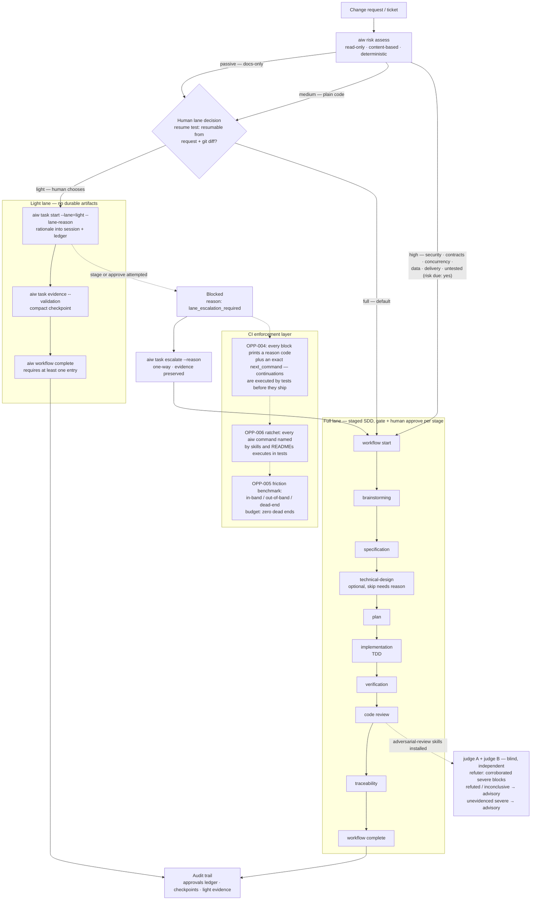

# Architecture

```text
CLI
 └── Core runtime
      ├── Package manager
      ├── Project scanner and profiler
      ├── AI project interpreter
      ├── Recommendation engine
      ├── Personalization engine
      ├── Resource registry
      ├── Validation and evidence engine
      ├── Opt-in telemetry boundary
      ├── Plugin authoring SDK
      ├── Local dashboard
      ├── Multi-agent scheduler
      └── Adapter manager
             ├── Codex
             ├── Claude Code
             ├── Cursor
             ├── Gemini CLI
             ├── GitHub Copilot
             └── Universal
```

## Source of truth

`.aiw/` contains the neutral manifest, lockfile, project profile, selected resources, and versioned checkpoints. Generated specifications, plans, docs, and artifacts live under `.aiw/generated/`.

Target files such as `.cursor/rules`, `.claude/skills`, or Codex skill directories are generated by adapters and must not be treated as canonical state.

## Runtime lifecycle

1. Discover the project.
2. Build or update the project profile.
3. Resolve package dependencies.
4. Recommend capabilities.
5. Request user decisions.
6. Generate personalized resources.
7. Render target-specific files.
8. Validate configuration and evidence.
9. Record the operation.

Project analysis is hybrid: deterministic detectors establish observable facts, while a scoped AI interpreter explains conventions and produces recommendations. AI output is never confirmed project state without user approval.

## Human workflow approvals

Workflows run in one of two lanes. The **full lane** (default, and the only non-interactive default) is the staged approval sequence below. The **light lane** (`aiw task start --lane=light --lane-reason=...`, human-chosen via the resume test — work is small when it could be resumed from the request plus `git diff`) skips durable spec/plan artifacts: validation evidence is recorded per entry (`aiw task evidence`), completion requires at least one entry, and the lane plus rationale are written into the session and approval ledger for audit. Stage commands in the light lane block with a `lane_escalation_required` reason until `aiw task escalate --reason=...` moves the workflow to the full lane; recorded evidence is preserved and linked. Escalation is one-way; the full lane then runs the complete approval sequence.

## Current flow



Reading notes:

- `aiw risk assess` is **advisory**: it informs the lane decision and flags risk due; it never forces a lane or bypasses approval.
- The light lane is never agent-chosen: `resources/skills/ticket.md` routes it through the host's blocking question widget with the resume test stated verbatim.
- Every blocking exit on the diagram prints `[reason: <code>]` and either `Next: run \`aiw ...\`` or an explicit terminal statement — the full mapping lives in [Continuation inventory](continuation-inventory.md).
- A `high` risk assessment with an active workflow points at continuing the workflow (gate and approve); without one it names `aiw workflow start`.

The SDD approval contract models the ordered stages brainstorming, specification, technical design, plan, implementation, verification, review, and traceability. Brainstorming and technical design are optional; skipping either requires a human-accepted reason. Every other stage must be approved. Automated quality-gate results are stored separately from human decisions and can only move an artifact to pending review, never directly to approved.

Each approval is scoped to one workflow ID and bound to a SHA-256 fingerprint of the exact artifact reviewed, so a later feature cannot reuse earlier approvals. A content change or rejection makes that stage and its descendants stale. The CLI persists the versioned ledger in `.aiw/approvals.yml`, blocks stage commands when prerequisites are unresolved, and keeps passing quality gates distinct from human approval. The generated bootstrap and stage skills require the host's native blocking question widget for human decisions when available, with a waiting chat prompt as fallback. Approval records provide an audit trail but cannot prove the identity of a respondent or independently verify that the host widget was used.

Every stage has a stable evidence path and an automated completeness gate. Design, implementation, review, and traceability use explicit report templates; a passing completeness check still leaves the stage pending until a human accepts the exact evidence.

## Modularity

The CLI is an entry point, not the business layer. Filesystem, package providers, scanners, recommendation engines, generators, validators, and adapters must be replaceable through interfaces and dependency injection.

## Telemetry

Telemetry is disabled by default and separated from command execution through an injectable client. The core emits only user-approved aggregate fields and does not own a network transport. Collector failures are isolated from workflow results.

## Local dashboard

`aiw ui` starts an HTTP server bound exclusively to `127.0.0.1`. It projects the neutral `.aiw/` state into an English HTML dashboard and JSON read model. The page uses no external assets or client-side scripts. Migration posts require the exact `MIGRATE` confirmation and delegate to the existing target command, preserving its conflict, backup, and rollback behavior.

## Multi-agent orchestration

The orchestration domain parses a strict, versioned task graph and schedules dependency waves with bounded parallelism. Preview is deterministic and read-only. Execution requires the explicit `--execute` flag and an injected `AgentOrchestrator`; this keeps Codex, Claude, Gemini, Orca, and future runtimes outside the core. Failed tasks block only their descendants, while independent work continues. Completed outcomes are recorded once in a versioned `.aiw/checkpoints/orchestration-<plan>.yml` checkpoint.

## Self-hosting

The repository uses the `multileaf/aiw-self-hosting` package. This package supplies the workflow resources required to develop AI Workflow itself, including SDD skills, quality rules, specialist agents, lifecycle hooks, and artifact templates.

Behavioral changes are validated against this repository with `aiw self-validate --ticket=TYPE-000`. The command runs the complete project quality pipeline and writes deterministic evidence to `.aiw/checkpoints/self-validation-<ticket>.yml`, including required AIW state and the generated artifacts inspected during the run. Checkpoints are reviewable project history and are not part of the ignored `.aiw/generated` tree.
